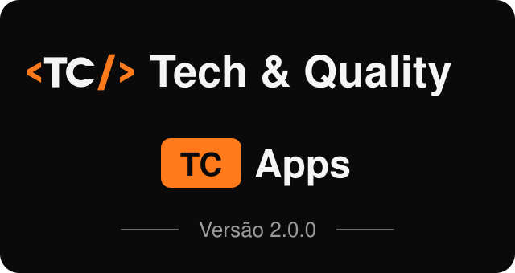

<div align="center">



# Thiago Cezar

**Software Development Engineer in Test (SDET)**
TC Tech & Quality

[](https://thiagotcezar.github.io/tc-portfolio/)
[](#-trajetória)
[](#-stack)

</div>

```console
thiago@tc-tech:~$ whoami && cat sobre.txt
```

## 👋 Sobre

**Software Development Engineer in Test (SDET)** com **10 anos de experiência** em Quality Engineering, especializado em estratégias de qualidade e automação de testes **Web, Mobile e APIs**.

Atuo em todo o ciclo de desenvolvimento, desde refinamentos e definição de critérios de aceite até testes E2E, integração, regressivos, smoke e validações de APIs. Promovo **Quality Mindset**, **Shift-Left Testing** e prevenção de defeitos em parceria com Engenharia, Produto e Negócio.

## 🧰 Stack

| Área | Ferramentas |
| --- | --- |
| **Automação** |       Capybara · HTTParty |
| **Linguagens** |     |
| **Ecossistema Playwright** | Test Runner · Trace Viewer · Playwright MCP · Allure Report · axe-core (a11y) · Percy (visual testing) |
| **APIs & dados** | Postman/Newman · Swagger/OpenAPI · Node.js · SQL/MySQL · OpenSearch |
| **CI/CD & versionamento** |     Bitbucket · Azure DevOps · Bitrise |
| **Device farms** | Sauce Labs · AWS Device Farm |

## 🚀 Trajetória

| Período | Cargo | Empresa | Destaques |
| --- | --- | --- | --- |
| mar/2021 – atual | **Software Development Engineer in Test (SDET)** | abastece-aí | Liderança técnica em qualidade, automação de testes e disseminação do mindset de qualidade em todo o ciclo de desenvolvimento. |
| jul/2020 – mar/2021 | **Technical Lead Quality Assurance** | TradersClub | Arquitetura de automação Web/Mobile/API com Ruby, Appium, Capybara, HTTParty e Cucumber. Entrevistas técnicas. |
| abr/2019 – jul/2020 | **Senior Software Quality Assurance** | Fleury Medicina e Saúde | Arquitetura de automação nas 3 frentes; testes de API com Postman/Newman; palestrante no 1º Meetup Fleury Digital. |
| fev/2019 – dez/2022 | **Instrutor de treinamento** | ACerT | Automação web (Capybara), mobile (Appium) e API (HTTParty), BDD/Gherkin com Cucumber e Ruby. |
| mai/2018 – mai/2019 | **Quality Assurance Mobile** | ViajaNet | Automação mobile, palestras em Agile Testing e treinamentos DOJO para o time de QA. |
| fev/2018 – mai/2018 | **Quality Assurance Mobile** | FTD Educação | Qualidade do produto Android/iOS e treinamentos comportamentais dentro do Scrum. |
| jun/2017 – fev/2018 | **Quality Assurance Web/Mobile** | Inmetrics | BDD com Cucumber, Ruby, Capybara/Selenium/Calabash/Appium, CI com Jenkins, Scrum e Jira. |
| set/2016 – jun/2017 | **Software Tester** | Spread Tecnologia | Testes manuais, massas, funcional, sanity, smoke, integração e regressivo. Gestão via HP-ALM. |
| ago/2011 – ago/2012 | Estagiário de suporte de informática | Prefeitura de SP | Manutenção nos equipamentos da sala de informática. |

## 🎤 Palestras e treinamentos

- **1º Meetup ViajaNet** · *Scrum: Agile Testing*, o olhar do QA sobre Scrum.
- **Make Your Experience** · Universidade São Judas Tadeu (nov/2019), 2 dias sobre automação de testes web e mobile.
- **1º Meetup Fleury Digital** · palestrante convidado sobre Agile Testing e automação.
- **Ex-instrutor** na FIQ (Focus in Quality) e na ACerT Certificações e Treinamentos.

## 🎓 Formação

| Instituição | Curso | Período |
| --- | --- | --- |
| Universidade Cruzeiro do Sul | Tecnólogo, Análise e Desenvolvimento de Sistemas | 2017 – 2019 |
| Senac Brasil | Gestão e Negócios | 2013 – 2014 |
| Star Bit, Educação e Profissões | Tecnologia da Informação | 2008 – 2010 |

### Certificações

- **Certified Management 3.0, Foundation Workshop** · Management 3.0 · jan/2021 · credencial `210180777`
- **Scrum Foundation Professional Certificate** · Certiprof · jan/2019 · credencial `30992466`
- **Scrum Fundamentals Certified** · VMEdu.com · mai/2018 · credencial `627538`

## 💬 Recomendações

> Ótimo profissional, sempre disposto a ajudar a equipe e criar planos objetivos para melhoria do nosso trabalho. O Thiago tem uma didática muito boa referente a automação de testes, fazendo com que a equipe sempre mantenha o interesse e o conhecimento no mesmo nível.
>
> **Leandro Lemos**, Analista de QA Sênior · Estratégia de Testes & Automação

> Ótimo profissional, com amplo conhecimento em QA envolvendo testes automatizados e Scrum. Thiago é um exemplo de profissional indispensável em uma equipe.
>
> **Rafael Magalhães**, Staff Software Developer @ TouchTunes

---

## 🛠️ Sobre este repositório

Código do site [thiagotcezar.github.io/tc-portfolio](https://thiagotcezar.github.io/tc-portfolio/): HTML, CSS e JavaScript puros, sem build. Layout em grid (bento), com seletor de idioma **PT/EN** e de tema **claro/escuro** no topo; as escolhas ficam salvas no navegador. Os textos ficam no objeto `I18N` e nas listas de dados no fim de `site/index.html`.

```
site/
├── index.html        # página única do portfólio
├── brand-lockup.svg  # lockup de marca (logo + nome, selo TC, versão)
└── favicon.svg
VERSION               # versão atual do app
.github/workflows/deploy-pages.yml   # publica site/ no GitHub Pages a cada push na main
```

### Marca e versão

O lockup segue o padrão: **logo + Tech & Quality**, abaixo o selo **TC** na cor do app (laranja `#ff7a1a`) + **Apps**, e por fim **Versão X.Y.Z** entre traços. A versão vem do arquivo `VERSION`; ao mudar, atualize também `site/brand-lockup.svg`, o `<meta name="version">` e o rodapé de `site/index.html`.

Para ver localmente:

```bash
python3 -m http.server -d site 8000   # http://localhost:8000
```

<div align="center">
<sub>TC TECH & QUALITY · CNPJ 68.364.741/0001-95</sub>
</div>
